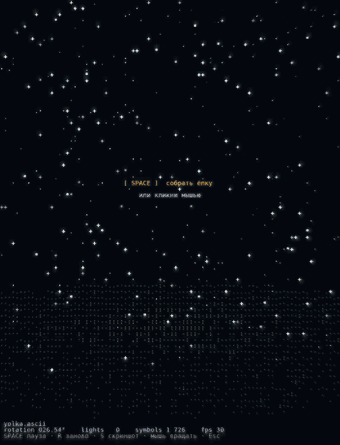

# ASCII-ёлка

Новогодняя ёлка из цифр и математических знаков. Нажимаешь пробел — она собирается из вихря символов, загорается гирлянда, с неба падают подарки, идёт снег.



**Посмотреть в браузере:** https://mmm0bucks.github.io/ascii-yolka/
Первый раз грузится долго — подожди немного.

## Как запустить у себя

Нужен Python 3.10 или новее.

```
python -m venv .venv
.venv\Scripts\activate
pip install -r requirements.txt
python yolka/main.py
```

На Linux и macOS вторая строка другая: `source .venv/bin/activate`.

## Управление

| Клавиша | Что делает |
|---|---|
| Пробел или клик | собрать ёлку, потом пауза |
| R | собрать заново |
| S | сохранить скриншот |
| Тянуть мышью | вращать |
| Esc | выход |

## Как настроить

В самом начале файла `yolka/main.py` есть блок переменных: текст поздравления, скорость вращения и снега, яркость гирлянды, подарков и звезды. Меняешь число — меняется картинка.

## Как это работает

Ёлка — это примерно 37 тысяч точек в 3D. Каждый кадр они поворачиваются и ложатся на сетку 88×74 символа. В каждой клетке остаётся ближайшая точка, а символ подбирается по её яркости: тёмное — точки и дефисы, светлое — `8`, `#`, `@`.

Сделано на Python: pygame-ce и numpy. В браузере работает через pygbag.

Идея подсмотрена в ролике с подписью `wcminh.ascii`, код написан с нуля. Шрифт — DejaVu Sans Mono (лицензия в `docs/DejaVu-LICENSE.txt`).
